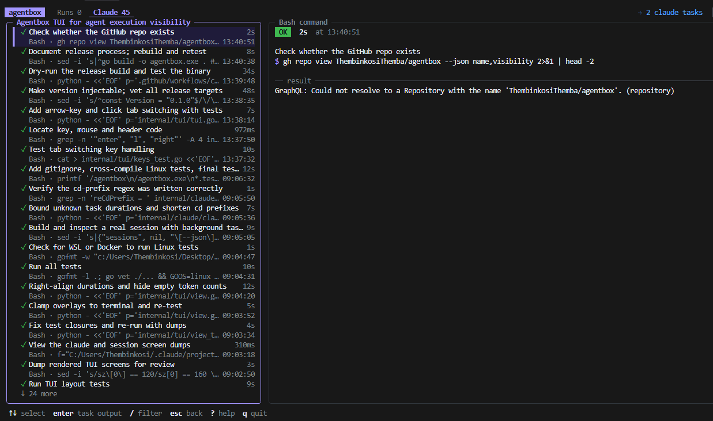

<h1 align="center">agentbox</h1>

<p align="center">
  <strong>See and manage everything your coding agents run.</strong>
</p>

<p align="center">
  A terminal dashboard and CLI for the builds, tests, dev servers and background tasks started by Claude Code and other agents. See what's running, what failed and what it printed. Give agents a way to run long commands that outlive their shell tool's time limit, and stay under your control.
</p>

<p align="center">
  <a href="https://github.com/ThembinkosiThemba/agentbox/actions/workflows/ci.yml"></a>
  <a href="https://github.com/ThembinkosiThemba/agentbox/releases/latest"></a>
  
</p>

<p align="center">
  
</p>

## Install

**Linux / macOS**

```sh
curl -fsSL https://raw.githubusercontent.com/ThembinkosiThemba/agentbox/main/install.sh | sh
```

**Windows (PowerShell)**

```powershell
irm https://raw.githubusercontent.com/ThembinkosiThemba/agentbox/main/install.ps1 | iex
```

The installer downloads the right binary for your OS and CPU, checks it against the published checksum, and adds it to your PATH. Open a new terminal afterwards and `agentbox` works everywhere. See [installation](docs/install.md) for options, manual downloads and building from source.

## Quick start

Open the dashboard:

```sh
agentbox
```

Claude Code and Antigravity CLI (`agy`) sessions on this machine show up in the **Claude** and **Agy** tabs automatically, with every command they ran and every background task. No setup needed.

Run something through agentbox, and it appears in the **Runs** tab:

```sh
agentbox run -d --name dev -- "npm run dev"   # start in the background
agentbox logs dev -f                          # follow its output
agentbox kill dev                             # stop it and everything it started
```

Pin it to your taskbar: the installers add agentbox to the Start menu (or your Linux applications menu). From a source build, run `agentbox shortcut`.

Have your agents use agentbox for long-running commands:

```sh
agentbox guide >> ~/.claude/CLAUDE.md   # or a project's CLAUDE.md / GEMINI.md / AGENTS.md
```

## Documentation

- [Installation](docs/install.md): all platforms, checksums, building from source
- [Using agentbox with coding agents](docs/agents.md): how agents start, wait on and stop runs
- [The dashboard](docs/dashboard.md): tabs, views and keys
- [CLI reference](docs/cli.md): every command, flag and exit code
- [How it works](docs/how-it-works.md): supervisors, process trees, state on disk
- [Development](docs/development.md): building, testing and releasing
